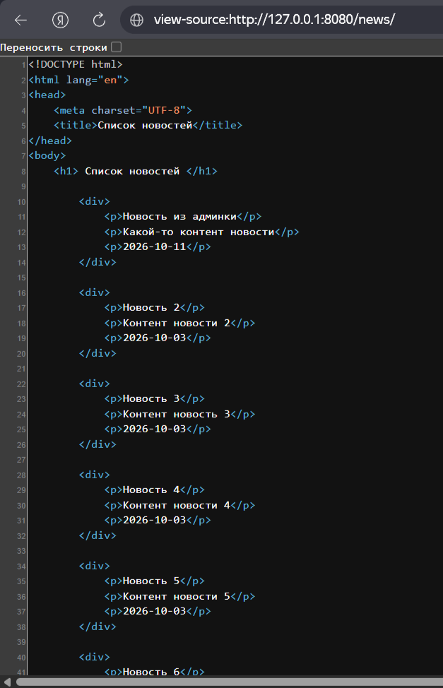
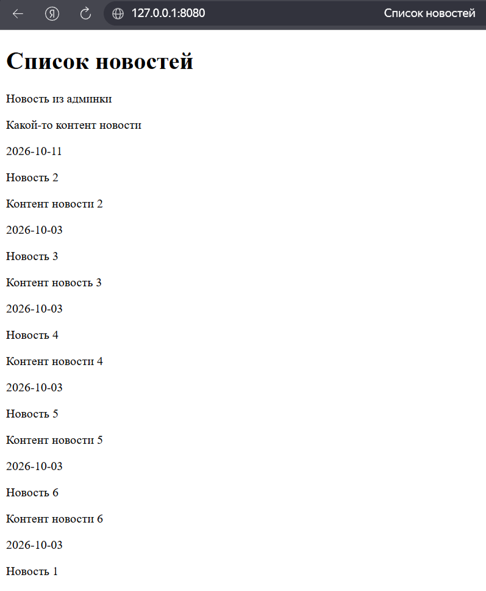
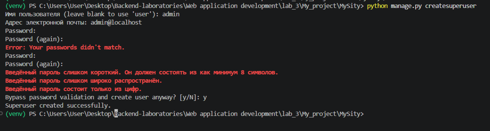
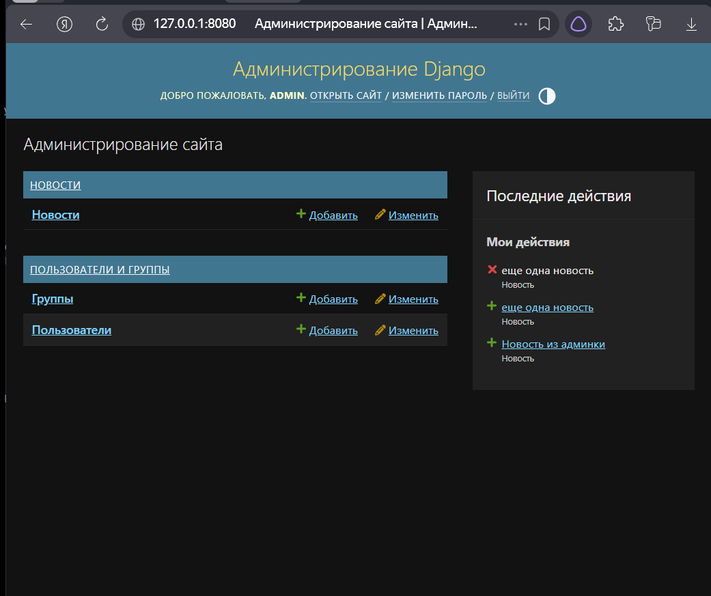
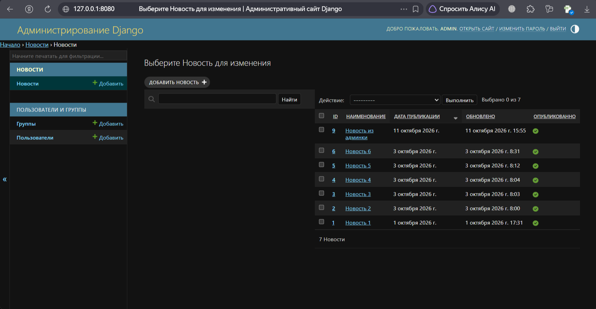

# Лабораторная работа №3. Шаблоны. Админка Django

**Студент:** Ризаханов Имам Заурович
**Группа:** ПИЖ-б-о-25-2
**Вариант:** 7
**Технология:** Python + Django

---

## Часть 1. Теоретическое обоснование

**Шаблон (Template)** — это обычный HTML-файл, в который вставляются данные из модели. Django ищет шаблоны в папке `templates` внутри приложения. Рекомендуется внутри `templates` создавать подпапку с именем приложения (`templates/news/`), чтобы избежать конфликтов имён.

**Рендеринг** — процесс наполнения шаблона данными из модели. Выполняется функцией `render()` из модуля `django.shortcuts`.

**Три инструмента шаблонизатора Django:**

| Инструмент | Синтаксис | Назначение |
|-----------|-----------|------------|
| Директивы | `{{ }}` | Вывод значений из контекста |
| Теги | `` | Управление логикой (циклы, условия) |
| Фильтры | `\|` | Преобразование значений перед выводом |

**Контекст** — словарь с данными, передаваемыми в шаблон:

```python
context = {'news': news, 'title': 'Список новостей'}
return render(request, 'news/index.html', context)
```

**Админка Django** — встроенная веб-панель управления моделями, доступна по адресу `/admin/`. Для входа создаётся суперпользователь командой:

```bash
python manage.py createsuperuser
```

**Регистрация модели в админке:**

```python
from django.contrib import admin
from .models import News
admin.site.register(News)
```

**Настройка отображения через `ModelAdmin`:**

```python
class NewsAdmin(admin.ModelAdmin):
    list_display = ('id', 'title', 'created_at', 'updated_at', 'is_published')
    list_display_links = ('id', 'title')
    search_fields = ('title', 'content')
admin.site.register(News, NewsAdmin)
```

**Подкласс `Meta`** — вложенный класс с настройками модели:

| Атрибут | Назначение |
|---------|-----------|
| `verbose_name` | Имя модели в единственном числе |
| `verbose_name_plural` | Имя модели во множественном числе |
| `ordering` | Сортировка по умолчанию |

**`verbose_name` поля** — читаемое имя поля в админке:

```python
title = models.CharField(max_length=150, verbose_name='Наименование')
```

**`apps.py`** — файл настроек приложения. Атрибут `verbose_name` задаёт название приложения в админке.

---

## Часть 2. Практическая часть

### 2.1. Вывод данных модели в браузер

В файле `news/views.py` был реализован контроллер `index`, который получает все новости из модели и передаёт их в шаблон:

```python
from django.shortcuts import render
from django.http import HttpResponse
from .models import News

def index(request):
    news = News.objects.all()
    context = {
        'news': news,
        'title': 'Список новостей'
    }
    return render(request, 'news/index.html', context)
```

Первоначально ответ формировался вручную через `HttpResponse` с HTML-строкой, но по мере роста кода это стало неудобно. Поэтому HTML был вынесен в отдельный шаблон.

### 2.2. Создание шаблона

Внутри приложения `news` создана папка `templates/news/`, а в ней файл `index.html`. Это стандартная структура Django: подпапка с именем приложения внутри `templates` помогает избежать конфликтов имён при сборке проекта.

Содержимое `news/templates/news/index.html`:

```html
<!DOCTYPE html>
<html lang="en">
<head>
    <meta charset="UTF-8">
    <title>{{ title }}</title>
</head>
<body>
    <h1>{{ title }}</h1>
    
        <div>
            <p>{{ item.title }}</p>
            <p>{{ item.content }}</p>
            <p>{{ item.created_at|date:"Y-m-d" }}</p>
        </div>
        <hr>
    
</body>
</html>
```

Здесь:

- `{{ title }}` — директива, выводящая заголовок страницы;
- `` — тег, организующий цикл по новостям;
- `{{ item.created_at|date:"Y-m-d" }}` — директива с фильтром, форматирующая дату.


### 2.3. Просмотр исходного кода страницы

Чтобы убедиться, что Django корректно отрендерил шаблон, откроем исходный код страницы: на `http://127.0.0.1:8080/news/` нажимаем **правой кнопкой мыши** → **«Просмотреть исходный код»** (или **Ctrl+U**).

В открывшемся окне виден **готовый HTML** — вместо директив `{{ }}` и тегов `` подставлены **реальные значения** из модели.




### 2.4. Локализация

В `MySity/settings.py` изменён язык проекта:

```python
LANGUAGE_CODE = 'ru'
```

Это позволяет выводить даты в привычном русском формате (`9 октября 2026 г.`) и переводит стандартные элементы админки на русский язык.

### 2.5. Сортировка новостей

Сортировка задана через подкласс `Meta` модели `News` — так порядок применяется одинаково и в админке, и на сайте:

```python
class Meta:
    verbose_name = 'Новость'
    verbose_name_plural = 'Новости'
    ordering = ['-created_at']
```

### 2.6. Результат на сайте

После запуска сервера (`python manage.py runserver 8080`) и перехода на `http://127.0.0.1:8080/news/` отображается список новостей. Дата каждой новости выводится в формате `2026-10-03`, что соответствует применённому фильтру `date:"Y-m-d"`.



---

### 2.7. Настройка админки

В файле `news/admin.py` модель `News` зарегистрирована с классом-настройщиком `NewsAdmin`:

```python
from django.contrib import admin
from .models import News


class NewsAdmin(admin.ModelAdmin):
    list_display = ('id', 'title', 'created_at', 'updated_at', 'is_published')
    list_display_links = ('id', 'title')
    search_fields = ('title', 'content')


admin.site.register(News, NewsAdmin)
```

Что это даёт:

- `list_display` — столбцы в списке новостей: `id`, `title`, `created_at`, `updated_at`, `is_published`.
- `list_display_links` — столбцы `id` и `title` становятся кликабельными, ведут в форму редактирования.
- `search_fields` — появляется поле поиска по полям `title` и `content`.


### 2.8. Создание суперпользователя

В терминале выполнено:

```bash
python manage.py createsuperuser
```

Введены данные:

- **Имя пользователя:** admin
- **Адрес электронной почты:** admin@localhost
- **Пароль:** введён и подтверждён.

Django успешно создал суперпользователя:

```
Superuser created successfully.
```




### 2.9. Русификация модели и приложения

Чтобы админка отображалась по-русски, добавлены:

**В `news/models.py`** — читаемые имена полей и модели:

```python
class News(models.Model):
    title = models.CharField(max_length=150, verbose_name='Наименование')
    content = models.TextField(blank=True, verbose_name='Контент')
    created_at = models.DateTimeField(auto_now_add=True, verbose_name='Дата публикации')
    updated_at = models.DateTimeField(auto_now=True, verbose_name='Обновлено')
    photo = models.ImageField(upload_to='photos/%Y/%m/%d', verbose_name='Фото', blank=True)
    is_published = models.BooleanField(default=True, verbose_name='Опубликовано')

    def __str__(self):
        return self.title

    class Meta:
        verbose_name = 'Новость'
        verbose_name_plural = 'Новости'
        ordering = ['-created_at']
```

**В `news/apps.py`** — читаемое имя приложения:

```python
from django.apps import AppConfig

class NewsConfig(AppConfig):
    default_auto_field = 'django.db.models.BigAutoField'
    name = 'news'
    verbose_name = 'Новости'
```


### 2.10. Главная страница админки и список новостей

После входа по адресу `http://127.0.0.1:8080/admin/` открывается главная страница админки. Все стандартные разделы и названия переведены на русский язык.



Страница со списком новостей тоже на русском.




---

### 2.11. Миграции

После всех изменений модели (добавление `verbose_name`, `blank=True`, `Meta`, изменение типа полей) были созданы и применены миграции:

```bash
python manage.py makemigrations
python manage.py migrate
```

**Что это делает:**

- `makemigrations` — Django сравнивает текущее состояние модели с последней миграцией и создаёт **новый файл миграции** (например, `0002_alter_news_options_alter_news_content_and_more.py`), в котором описаны все изменения.
- `migrate` — применяет эти изменения к **базе данных**: изменяет схему таблицы `news_news` в соответствии с новыми настройками модели.

Без этих команд **изменения в модели не вступят в силу** — админка и сайт продолжат работать со старой структурой таблицы.

---

## Часть 3. Итог

### Вывод

В ходе лабораторной работы №3 были изучены шаблоны Django и административная панель. Освоен процесс рендеринга: данные из модели передаются в HTML-шаблон через контекст и выводятся с помощью директив, тегов и фильтров. Создан шаблон `index.html` для отображения списка новостей, настроена локализация (`LANGUAGE_CODE = 'ru'`), применён фильтр `date` для кастомного форматирования даты в формате `Y-m-d`.

Изучена административная панель Django: создан суперпользователь, зарегистрирована модель `News`, настроено отображение списка через класс `NewsAdmin` (`list_display`, `list_display_links`, `search_fields`). Добавлены атрибуты `Meta` (`verbose_name`, `verbose_name_plural`, `ordering`), настроено название приложения в админке через `verbose_name` в `apps.py`. Добавлены русские названия полей через `verbose_name`. Полученные навыки позволяют создавать полноценные веб-страницы на основе данных из БД и управлять ими через админку.

---

### Ответы на контрольные вопросы

**1. Что такое шаблон в Django и для чего он используется?**

Шаблон — это HTML-файл, в который вставляются данные из модели. Используется для формирования страницы с данными. Django ищет шаблоны в папке `templates` внутри приложения.

**2. Что такое рендеринг?**

Рендеринг — процесс наполнения файла шаблона данными из модели, то есть формирование страницы с данными. Выполняется через функцию `render()` из `django.shortcuts`.

**3. С какими тремя объектами работает шаблонизатор Django?**

- **Директивы** — переменные для вывода значений (`{{ title }}`).
- **Теги** — управляют генерацией вывода (``, ``).
- **Фильтры** — преобразуют значения перед выводом (`{{ item.created_at|date:"Y-m-d" }}`).

**4. Что такое контекст в Django?**

Контекст — словарь с данными, которые передаются в шаблон. Например: `{'news': news, 'title': 'Список новостей'}`. Третий параметр функции `render()`.

**5. Как подключить шаблон к контроллеру?**

Через функцию `render()` из модуля `django.shortcuts`:

```python
return render(request, 'news/index.html', context)
```

**6. Что такое тег `` и для чего он используется?**

Тег `for` организует цикл по объектам. Используется для перебора записей из QuerySet:

```html

    <p>{{ item.title }}</p>

```

**7. Что такое фильтр и как его использовать?**

Фильтр преобразует значение перед выводом. Пример: `{{ item.created_at|date:"Y-m-d H:i:s" }}` — форматирует дату в указанный формат.

**8. Как изменить язык приложения в Django?**

В `settings.py` изменить параметр `LANGUAGE_CODE`:

```python
LANGUAGE_CODE = 'ru'
```

**9. Как создать суперпользователя для админки?**

```bash
python manage.py createsuperuser
```

Ввести имя пользователя, email и пароль. После создания зайти в `/admin/`.

**10. Как зарегистрировать модель в админке Django?**

В файле `admin.py`:

```python
from django.contrib import admin
from .models import News
admin.site.register(News)
```

**11. Как настроить отображение модели в админке?**

Через класс `ModelAdmin`:

```python
class NewsAdmin(admin.ModelAdmin):
    list_display = ('id', 'title', 'created_at', 'updated_at', 'is_published')
    list_display_links = ('id', 'title')
    search_fields = ('title', 'content')
admin.site.register(News, NewsAdmin)
```

**12. Для чего нужен подкласс `Meta` в модели?**

Для настройки метаданных модели:
- `verbose_name` — имя модели в единственном числе.
- `verbose_name_plural` — имя модели во множественном числе.
- `ordering` — сортировка по умолчанию.

**13. Что такое `verbose_name`?**

Атрибут, задающий читаемое имя поля (или модели) для отображения в админке и формах. Пример: `title = models.CharField(max_length=150, verbose_name='Наименование')`.

**14. Как изменить название приложения в админке?**

В файле `apps.py` добавить `verbose_name`:

```python
class NewsConfig(AppConfig):
    name = 'news'
    verbose_name = 'Новости'
```

**15. Зачем нужно поле `blank=True`?**

`blank=True` разрешает полю быть пустым в формах и в админке. Например, `photo = models.ImageField(upload_to='...', blank=True)` — фотографию можно не загружать.