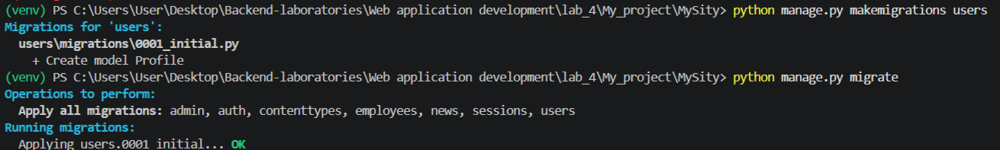
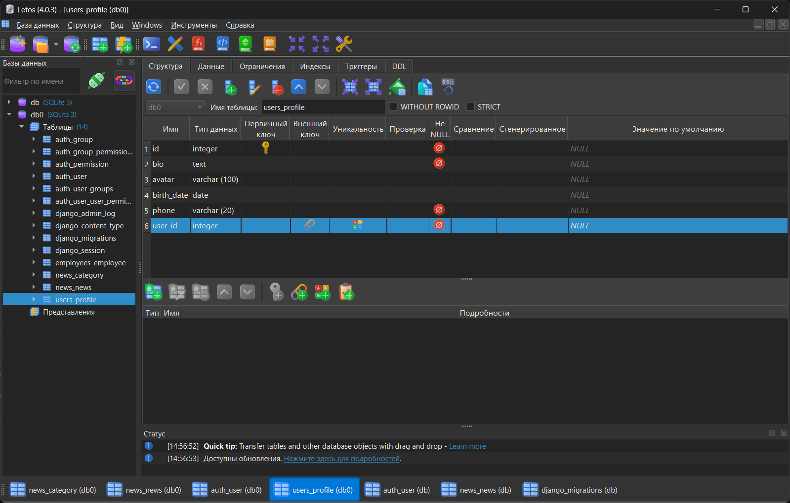
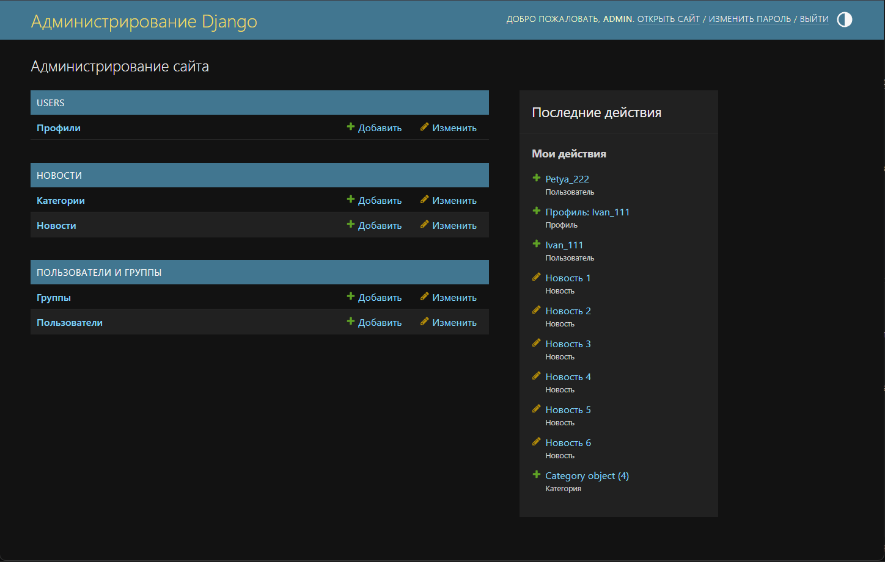
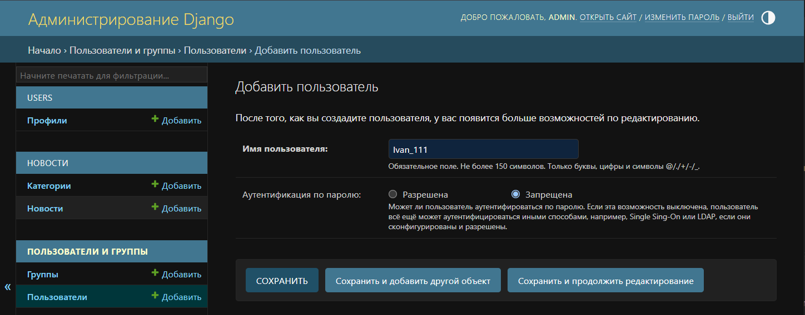
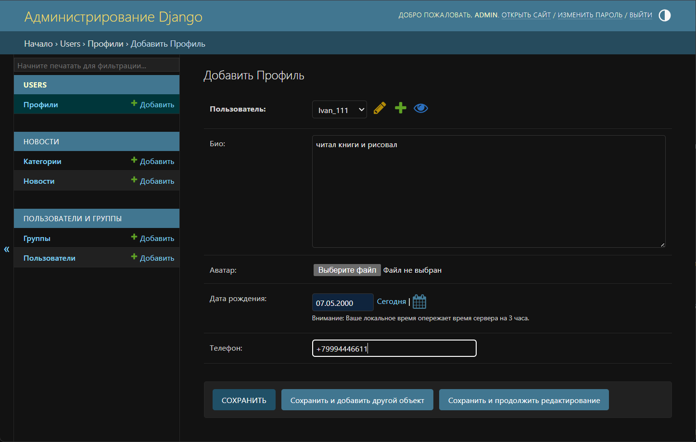
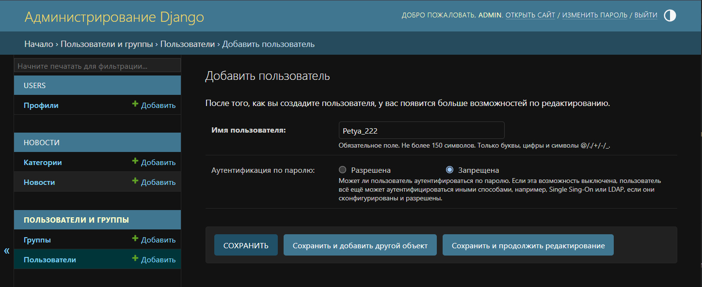
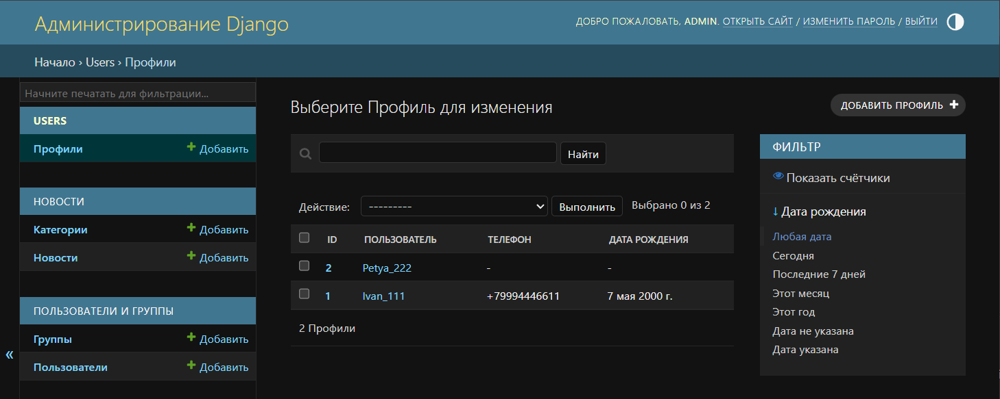
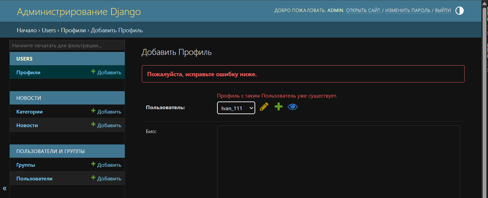
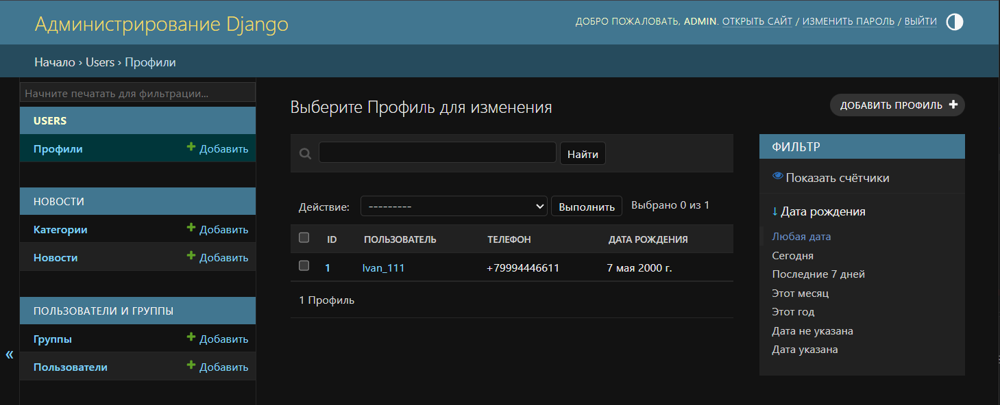
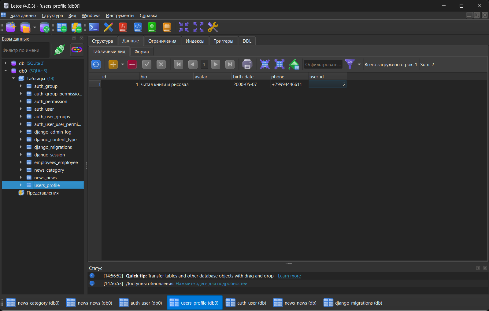

# Лабораторная работа №4. Связи между моделями Django

**Студент:** Ризаханов Имам Заурович
**Группа:** ПИЖ-б-о-25-2
**Вариант:** 7
**Технология:** Python + Django

---

## Цель работы

Освоить создание и настройку связей между моделями Django (`ForeignKey`, `ManyToManyField`, `OneToOneField`), изучить параметры связей (`on_delete`, `related_name`, `null`, `blank`, `default`), научиться применять миграции при добавлении связей к существующим моделям, а также настраивать отображение связанных данных в административной панели Django.

---

## Часть 1. Теоретическое обоснование

**Связи между моделями** нужны для организации **нормализованного хранения данных**. Вместо дублирования одних и тех же данных в разных таблицах используется **внешний ключ** — ссылка на запись в другой таблице.

Django предлагает **три класса для организации связей**:

| Класс | Тип связи | Пример |
|-------|-----------|--------|
| `ForeignKey` | Многие-к-одному | Одна категория — много новостей |
| `ManyToManyField` | Многие-ко-многим | Один пост — много тегов |
| `OneToOneField` | Один-к-одному | Один пользователь — один профиль |

**`OneToOneField(to, on_delete, **options)`** — связь «один-к-одному». Как `ForeignKey`, но с **ограничением `UNIQUE`** — у каждого объекта **ровно один** связанный.

**Параметр `on_delete`** — обязателен для `ForeignKey` и `OneToOneField`:

| Значение | Что делает |
|----------|-----------|
| `CASCADE` | Каскадное удаление — вместе с основным объектом |
| `PROTECT` | Запрещает удаление, если есть связи |
| `SET_NULL` | Устанавливает `NULL` (требует `null=True`) |
| `SET_DEFAULT` | Устанавливает значение по умолчанию |
| `RESTRICT` | Запрещает, но разрешает при `CASCADE` |
| `DO_NOTHING` | Ничего не делает (опасно) |

**Сигналы** (`post_save`) — механизм, позволяющий выполнять код автоматически после сохранения объекта. В варианте 7 используется для **автоматического создания профиля** при создании пользователя.

**`related_name`** — имя для обратной связи. Например, `user.profile` вместо `user.profile_set.first()`.

---

## Часть 2. Практическая часть

### 2.1. Постановка задачи (Вариант 7)

**Вариант 7: Социальная сеть — пользователи и профили**

| Компонент | Описание |
|-----------|----------|
| Первичная модель | `User` (стандартная модель Django) |
| Вторичная модель | `Profile` (био, аватар, дата рождения, телефон) |
| Тип связи | `OneToOneField` (один пользователь — один профиль) |
| `on_delete` | `CASCADE` |
| Дополнительно | Автоматическое создание профиля через сигнал `post_save` |

---

### 2.2. Создание приложения `users`

В терминале (venv активна) выполнена команда:

```bash
python manage.py startapp users
```

В `MySity/settings.py` добавлено приложение:

```python
INSTALLED_APPS = [
    'django.contrib.admin',
    'django.contrib.auth',
    'django.contrib.contenttypes',
    'django.contrib.sessions',
    'django.contrib.messages',
    'django.contrib.staticfiles',
    'news.apps.NewsConfig',
    'users.apps.UsersConfig',
]
```

---

### 2.3. Модель `Profile`

В файле `users/models.py`:

```python
from django.db import models
from django.contrib.auth.models import User
from django.db.models.signals import post_save
from django.dispatch import receiver


class Profile(models.Model):
    user = models.OneToOneField(User, on_delete=models.CASCADE, verbose_name='Пользователь')
    bio = models.TextField(blank=True, verbose_name='Био')
    avatar = models.ImageField(upload_to='avatars/%Y/%m/%d', blank=True, null=True, verbose_name='Аватар')
    birth_date = models.DateField(null=True, blank=True, verbose_name='Дата рождения')
    phone = models.CharField(max_length=20, blank=True, verbose_name='Телефон')

    def __str__(self):
        return f'Профиль: {self.user.username}'

    class Meta:
        verbose_name = 'Профиль'
        verbose_name_plural = 'Профили'


@receiver(post_save, sender=User)
def create_user_profile(sender, instance, created, **kwargs):
    if created:
        Profile.objects.create(user=instance)


@receiver(post_save, sender=User)
def save_user_profile(sender, instance, **kwargs):
    instance.profile.save()
```

**Что здесь:**

- **`user = models.OneToOneField(User, on_delete=models.CASCADE, ...)`** — связь «один-к-одному» с моделью `User`.
- **`on_delete=models.CASCADE`** — при удалении пользователя удаляется его профиль.
- **`bio`, `avatar`, `birth_date`, `phone`** — поля профиля.
- **`__str__`** — читаемое имя (используется `self.user.username`).
- **`Meta`** — русские имена.
- **Сигналы** `post_save` — создают профиль при создании пользователя и обновляют при обновлении.

---

### 2.4. Регистрация в админке

В файле `users/admin.py`:

```python
from django.contrib import admin
from .models import Profile


@admin.register(Profile)
class ProfileAdmin(admin.ModelAdmin):
    list_display = ('id', 'user', 'phone', 'birth_date')
    list_display_links = ('id', 'user')
    search_fields = ('user__username', 'phone')
```

---

### 2.5. Миграции

Выполнены команды:

```bash
python manage.py makemigrations
python manage.py migrate
```

**Что произошло:**

- Создан файл миграции `users/migrations/0001_initial.py`.
- В БД создана таблица `users_profile`.
- В таблице `users_profile` поле `user_id` — `FOREIGN KEY` на `auth_user.id`, с ограничением `UNIQUE`.

<br>



---

### 2.6. Проверка в админке

После запуска сервера (`python manage.py runserver 8080`) и входа в админку (`http://127.0.0.1:8080/admin/`) появился новый раздел **«Профили»**.



---

### 2.7. Ручное создание профиля

В разделе **«Профили»** нажата кнопка **«Добавить профиль»**. Выбран пользователь `Ivan_111` из выпадающего списка, заполнены поля `bio`, `avatar`, `birth_date`, `phone`.

<br>


---

### 2.8. Автоматическое создание профиля через сигнал

После добавления сигналов в `models.py` был создан новый пользователь `Petya_222` в разделе **«Пользователи»**.

**Что произошло:** профиль для `Petya_222` появился **автоматически** в разделе **«Профили»** (без ручного создания).

<br>



---

### 2.9. Проверка `OneToOneField` (ограничение `UNIQUE`)

При попытке создать **второй** профиль для пользователя `Ivan_111` Django выдал ошибку.



**Что это доказывает:** `OneToOneField` гарантирует, что у одного пользователя — **ровно один** профиль.

---

### 2.10. Проверка каскадного удаления

Пользователь `Petya_222` был удалён в разделе **«Пользователи»**. После этого профиль `Petya_222` автоматически исчез из раздела **«Профили»**.



**Что произошло:** `on_delete=CASCADE` удалил профиль вместе с пользователем.

---

### 2.11. Проверка в SQLiteStudio

В SQLiteStudio открыта база `db0`, найдена таблица `users_profile`. На вкладке **«Данные»** видны созданные профили с заполненным `user_id`.



---

## Часть 3. Итог

### Вывод

В ходе лабораторной работы №4 были изучены связи между моделями Django. Освоен тип связи `OneToOneField` — «один-к-одному» — на примере моделей `User` (стандартная модель Django) и `Profile`.

**Что было сделано:**

- Создано приложение `users`.
- Создана модель `Profile` с полями `bio`, `avatar`, `birth_date`, `phone`.
- Настроена связь `OneToOneField` на модель `User` с параметром `on_delete=CASCADE`.
- Настроено **автоматическое создание профиля** через сигналы `post_save`.
- Выполнены миграции — в БД появилась таблица `users_profile` с ограничением `UNIQUE` на `user_id` и внешним ключом на `auth_user`.
- Зарегистрирована модель в админке с настройками `list_display`, `list_display_links`, `search_fields`.
- Проверена работа **каскадного удаления** — при удалении пользователя профиль удаляется автоматически.
- Проверено ограничение `UNIQUE` — второй профиль для одного пользователя создать нельзя.

**Полученные навыки:** создание связей между моделями, настройка параметров (`on_delete`, `related_name`, `null`, `blank`), применение миграций к существующим моделям, настройка отображения связанных данных в админке, работа с сигналами `post_save`.

---

### Ответы на контрольные вопросы

**1. Что такое `OneToOneField` и чем отличается от `ForeignKey`?**

`OneToOneField` — связь «один-к-одному». Как `ForeignKey`, но с **ограничением `UNIQUE`** — у каждого объекта **ровно один** связанный.

**2. Зачем нужен `on_delete=CASCADE`?**

При удалении пользователя **удаляется** и его профиль. Без `CASCADE` — профиль **остался бы** «висеть» (или ошибка).

**3. Что такое `related_name`?**

Имя **обратной** связи. С `related_name='profile'` можно писать `user.profile` вместо `user.profile_set.first()`.

**4. Что такое сигналы `post_save`?**

Механизм, позволяющий **выполнять код** после **сохранения** объекта. В ЛБ — **создавать профиль** автоматически при создании пользователя.

**5. Как проверить, что `OneToOneField` работает?**

Попробовать создать **второй** профиль для **того же** пользователя — Django **выдаст ошибку** `IntegrityError` (нарушение `UNIQUE`).

**6. Что произойдёт, если удалить пользователя?**

Благодаря `on_delete=CASCADE` — **удалится** и его профиль.

**7. Какие типы связей существуют в Django?**

- `ForeignKey` — многие-к-одному.
- `ManyToManyField` — многие-ко-многим.
- `OneToOneField` — один-к-одному.

**8. Зачем нужен `null=True`?**

Разрешает полю быть `NULL` в БД. Для `avatar` и `birth_date` — потому что это необязательные поля.

**9. Зачем нужен `blank=True`?**

Разрешает полю быть пустым **в формах** (валидация на уровне Django).

**10. Что такое миграции?**

Механизм Django для отслеживания и применения изменений в структуре моделей к схеме БД.