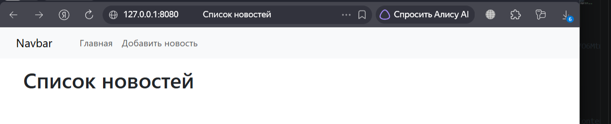
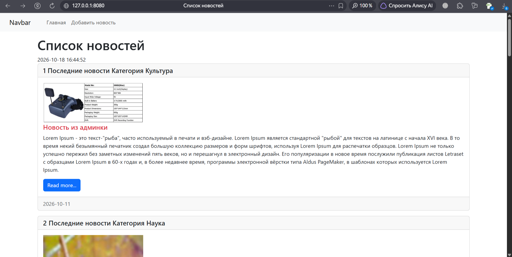

# Лабораторная работа №5. Bootstrap и шаблоны Django

**Студент:** Ризаханов Имам Заурович  
**Группа:** ПИЖ-б-о-25-2  
**Вариант:** 7  
**Технология:** Python + Django  

---

## Цель работы

Изучить основы работы с CSS-фреймворком Bootstrap, научиться подключать его через CDN, использовать компоненты Bootstrap (Navbar, Card, Media object) для создания адаптивного дизайна страниц. Освоить теги и фильтры шаблонизатора Django (`cycle`, `now`, `forloop.counter`) и настроить вывод изображений в шаблонах.

---

## Часть 1. Теоретическое обоснование

**Bootstrap** — это открытый и бесплатный HTML, CSS и JS фреймворк для быстрой вёрстки адаптивных дизайнов сайтов и веб-приложений.

**CDN (Content Delivery Network)** — это географически распределённая сетевая инфраструктура, обеспечивающая быструю доставку контента пользователям посредством оптимизации времени ответа серверов.

**Основные компоненты и инструменты Bootstrap, используемые в работе:**
* `Navbar` — навигационная панель в верхней части страницы.
* `Card` — структурированная карточка для изоляции контента (новости).
* `Media object` — контейнер для выравнивания изображений рядом с текстовыми блоками.
* `Сетка (Container, Row, Col)` — элементы разметки для адаптивного расположения блоков.

**Теги и фильтры шаблонизатора Django:**
* `` — цикл для последовательного перебора элементов.
* `` — чередование переданных аргументов при каждой итерации цикла.
* `` — отображение текущей даты и времени в заданном формате.
* `{{ forloop.counter }}` — переменная счетчика текущей итерации цикла (начиная с 1).
* `|date:"Y-m-d"` — фильтр форматирования даты публикации.

---

## Часть 2. Практическая часть

### 2.1. Подключение Bootstrap и создание базовой структуры страницы

На основе стартового шаблона с сайта getbootstrap.com был сформирован первоначальный каркас страницы `news/templates/news/index.html`. Подключение стилей выполнено через CDN с использованием версии Bootstrap 5.3.8 RTL. Внедрена переменная `{{ title }}` в тег `<title>` и заголовок страницы `<h1>`:

```html
<!doctype html>
<html lang="en">
  <head>
    <meta charset="utf-8">
    <meta name="viewport" content="width=device-width, initial-scale=1">
    <link rel="stylesheet" href="https://cdn.jsdelivr.net/npm/bootstrap@5.3.8/dist/css/bootstrap.rtl.min.css" integrity="sha384-CfCrinSRH2IR6a4e6fy2q6ioOX7O6Mtm1L9vRvFZ1trBncWmMePhzvafv7oIcWiW" crossorigin="anonymous">
    <title>{{title}}</title>
  </head>
  <body>
    <div class="container mt-3">
        <h1> {{title}} </h1>
    </div>
  </body>
</html>
```

### 2.2. Добавление и кастомизация компонента Navbar

Вместо стандартного статического заголовка была интегрирована навигационная панель `Navbar`. Из оригинального компонента удалена форма поиска и лишние выпадающие списки. Оставлены ссылки на «Главную» и «Добавить новость» с корректными путями (`href="/"`):

```html
<nav class="navbar navbar-expand-lg bg-body-tertiary">
    <div class="container-fluid">
        <a class="navbar-brand" href="/">Navbar</a>
        <button class="navbar-toggler" type="button" data-bs-toggle="collapse" data-bs-target="#navbarSupportedContent" aria-controls="navbarSupportedContent" aria-expanded="false" aria-label="Toggle navigation">
            <span class="navbar-toggler-icon"></span>
        </button>
        <div class="collapse navbar-collapse" id="navbarSupportedContent">
            <ul class="navbar-nav">
                <li class="nav-item"><a class="nav-link" href="/">Главная</a></li>
                <li class="nav-item"><a class="nav-link" href="/">Добавить новость</a></li>
            </ul>
        </div>
    </div>
</nav>
```

> **Визуальное состояние веб-сайта (Этап 1):** Вверху страницы отображается светлая адаптивная плашка навигационной панели с тремя кликабельными элементами: логотипом «Navbar» и расположенными в ряд ссылками «Главная» и «Добавить новость». Ниже панели находится крупный заголовок «Список новостей».



---

### 2.3. Внедрение компонента Card и комплексная интеграция тегов и изображений

Для отображения новостной ленты внутри сетки (`row` -> `col-md-12`) запущен цикл ``, выводящий карточки `Card`. 

В шапку карточки (`.card-header`) добавлены переменная счетчика `{{ forloop.counter }}` для автоматической нумерации публикаций, вызов метода модели `{{ item.my_func }}` и динамический вывод категории `{{ item.category }}`. 

Внутри тела карточки создана структура `.media`. Механизм `` проверяет наличие загруженного фото у новости. Через панель администратора к новости 6 было прикреплено изображение, поэтому у неё в карточке отображается реальное фото. У остальных новостей фотографии отсутствуют в базе данных, поэтому для них выводится стандартная заглушка (placeholder) из сервиса Picsum шириной 300px. 

Заголовок новости стилизуется тегом `` для поочередного окрашивания в **два цвета** (`text-danger` и `text-success`). В нижнем поле карточки (`.card-footer`) выводится отформатированная дата публикации с помощью фильтра `date:"Y-m-d"`.

**Итоговый код шаблона:**

```html
<!doctype html>
<html lang="en">
  <head>
    <meta charset="utf-8">
    <meta name="viewport" content="width=device-width, initial-scale=1">
    <link rel="stylesheet" href="https://cdn.jsdelivr.net/npm/bootstrap@5.3.8/dist/css/bootstrap.rtl.min.css" integrity="sha384-CfCrinSRH2IR6a4e6fy2q6ioOX7O6Mtm1L9vRvFZ1trBncWmMePhzvafv7oIcWiW" crossorigin="anonymous">
    <title>{{title}}</title>
  </head>
  <body>
    <nav class="navbar navbar-expand-lg bg-body-tertiary">
        <div class="container-fluid">
            <a class="navbar-brand" href="/">Navbar</a>
            <button class="navbar-toggler" type="button" data-bs-toggle="collapse" data-bs-target="#navbarSupportedContent" aria-controls="navbarSupportedContent" aria-expanded="false" aria-label="Toggle navigation">
                <span class="navbar-toggler-icon"></span>
            </button>
            <div class="collapse navbar-collapse" id="navbarSupportedContent">
                <ul class="navbar-nav">
                    <li class="nav-item"><a class="nav-link" href="/">Главная</a></li>
                    <li class="nav-item"><a class="nav-link" href="/">Добавить новость</a></li>
                </ul>
            </div>
        </div>
    </nav>
    
    <div class="container mt-3">
        <h1> {{title}} </h1>
        
        
        <div class="row">
            
            <div class="col-md-12">
                <div class="card mb-3">
                    <h5 class="card-header">
                        {{forloop.counter}}
                        {{item.my_func}}
                        Категория {{item.category}}
                    </h5>

                    <div class="card-body">
                        <div class="media">
                            
                                
                            
                                
                            
                            
                            <div class="media-body">
                                <h5 class="card-title "> {{item.title}} </h5>
                                <p class="card-text"> {{item.content}} </p>
                                <a href="#" class="btn btn-primary">Read more...</a>
                            </div>
                        </div>
                    </div>

                    <div class="card-footer text-body-secondary">
                        {{item.created_at|date:"Y-m-d"}}
                    </div>
                </div>
            </div>
            
        </div>
    </div>
    
  </body>
</html>
```

> **Визуальное состояние веб-сайта (Финальный этап):** Сразу под главным заголовком страницы отображается текущая дата и точное время сервера. Ниже выводится список новостей, каждая из которых оформлена в виде отдельной карточки. Шапка карточки содержит порядковый номер, текст метода «Последние новости» и категорию. Слева внутри карточки выводится загруженное фото или размытое изображение-placeholder. Текст статьи расположен справа от фото. Заголовок первой новости окрашен в **красный цвет** (`text-danger`), заголовок второй карточки — в **зеленый цвет** (`text-success`), третьей — снова в красный. Футер карточки содержит лаконичную дату публикации в формате `ГГГГ-ММ-ДД`.



---

## Часть 3. Итог

### Вывод

В ходе лабораторной работы №5 были успешно изучены и применены на практике возможности CSS-фреймворка Bootstrap 5 для проектирования отзывчивых веб-интерфейсов. Подключение библиотеки через CDN позволило развернуть стили мгновенно без скачивания файлов. Использование компонентов Navbar, Card и современных Flexbox-утилит выравнивания контента (d-flex, me-3) позволило преобразовать разрозненные сырые данные в структурированную новостную ленту.
В области работы с шаблонизатором Django были освоены управляющие конструкции для динамического вывода информации: тег  для автоматического переключения CSS-классов оформления, объект контекста {{ forloop.counter }} для организации сквозной нумерации, тег  для вывода системного времени, а также логическое ветвление  для безопасного рендеринга путей к медиафайлам или подстановки заглушек.

---

### Ответы на контрольные вопросы

1. **Что такое Bootstrap?**  
   Bootstrap — это открытый HTML, CSS и JS фреймворк для быстрой вёрстки адаптивных сайтов.

2. **Что такое CDN и зачем он нужен?**  
   CDN (Content Delivery Network) — сеть серверов для быстрой доставки контента. Позволяет подключать библиотеки без скачивания.

3. **Какие компоненты Bootstrap использовались в работе?**  
   Navbar (навигация), Card (карточка), Container (контейнер), Row/Col (сетка).

4. **Что делает тег ``?**  
   Чередует значения при каждой итерации цикла. Например, меняет цвет заголовка.

5. **Что делает тег ``?**  
   Выводит текущую дату и время в указанном формате.

6. **Как вывести номер итерации цикла?**  
   Использовать `{{ forloop.counter }}`.

7. **Как вывести изображение в шаблоне?**  
   Через `{{ item.photo.url }}` с проверкой ``.

8. **Зачем нужен фильтр `date`?**  
   Форматирует дату в нужный вид, например `Y-m-d`.